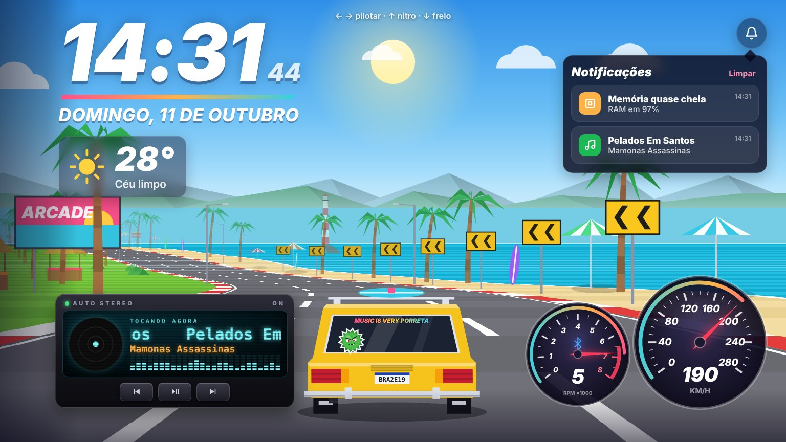

# In Santos 🏖️

Papel de parede interativo para Windows no estilo arcade retrô: uma Brasília amarela com prancha no teto acelerando por uma estrada à beira-mar, com relógio, clima, painel do carro e rádio que mostra a música tocando no Spotify.

## O que tem

- **Estrada infinita em pseudo-3D** com curvas, morros, mar, areia, guarda-sóis, barracas, salva-vidas e farol.
- **Céu que segue a hora real**: manhã, dia, pôr do sol e noite, com transições suaves. Quando chove de verdade, chove no papel de parede.
- **Relógio, data e clima** em destaque. O clima vem da [Open-Meteo](https://open-meteo.com/), sem chave de API.
- **Painel**: velocímetro e conta-giros com troca de marchas e indicador de Bluetooth.
- **Rádio**: capa, título rolando e equalizador seguindo o áudio real (via Lively).
- **Notificações**: mini janela no sininho com avisos de música, clima, CPU/RAM alta e lembretes.
- **Piloto automático**, que ultrapassa o tráfego sozinho, ou **controle pelas setas**: ← → para virar, ↑ para o nitro e ↓ para frear.

## Instalação

1. Instale o [Lively Wallpaper](https://www.rocksdanister.com/lively/), que é gratuito.
2. Baixe `index.html`, `LivelyInfo.json` e `thumbnail.jpg` e compacte os três num `.zip`, sem pasta dentro.
3. Arraste o `.zip` para a janela do Lively, ou use **+ → Escolher arquivo**.
4. Nas configurações do Lively, ative a entrada do mouse para o papel de parede.

> Também dá para abrir o `index.html` no navegador e apertar **F11**. Nesse modo o rádio não recebe a música, porque essa informação vem do Lively.

## Configuração

No topo do `index.html` há o bloco `CONFIG`:

| Opção | O que faz |
|---|---|
| `tema` | `'auto'` segue a hora; ou `'manha'`, `'dia'`, `'tarde'`, `'noite'` |
| `clima` | latitude e longitude da sua cidade (padrão: Santos-SP) |
| `corCarro` | cor da Brasília |
| `trafego`, `velocidade` | quantidade de carros e ritmo da corrida |
| `barraDeTarefas`, `iconesDesktop` | espaço reservado para a barra do Windows e os ícones da área de trabalho (px) |
| `chuvaNaTela` | liga/desliga a chuva sincronizada com o clima real |
| `lembretes` | ex.: `{ hora: '12:00', texto: 'Almoço' }` |

## Limitações

- As notificações do Windows (WhatsApp, e-mail etc.) não aparecem, porque o Lively não repassa esses dados.
- Os botões ⏮ ⏯ ⏭ do rádio precisam de um ajudante local na porta `8765`, que não está incluído neste repositório. Sem ele, os botões ficam apagados.
- O teclado depende de o Lively repassar as teclas para o papel de parede.
- O ícone de Bluetooth só mostra o estado real se o navegador do Lively permitir consultar o adaptador.

## Consumo

Cerca de 10 MB de memória para o código e por volta de 160 MB no total com o navegador embutido do Lively. Para economizar, ative no Lively a opção de pausar quando houver um app maximizado ou em tela cheia.
